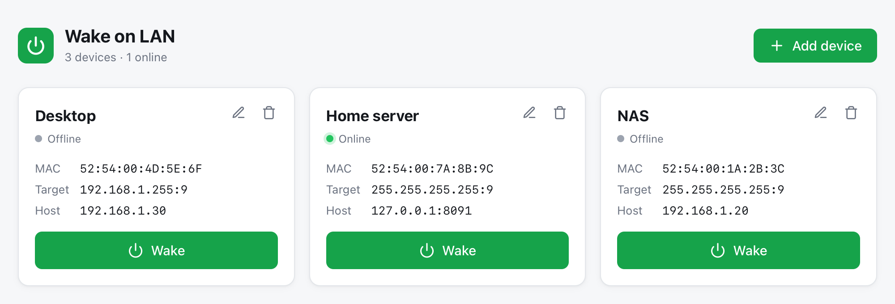

# Wake on LAN

Small web UI to wake machines on the LAN with a magic packet. Devices are stored in a JSON file;
no database, no web framework, no auth. The UI is a single embedded HTML page with plain JS/CSS.



## Running with Docker

A prebuilt image is published for `linux/amd64`, `linux/arm64` and `linux/arm/v7`:

```
ghcr.io/oneryx/wol:latest
```

Host networking is required: from a bridge network the broadcast only reaches the Docker bridge, not the LAN.
(Docker Desktop on macOS/Windows can't broadcast onto the LAN; run it on a Linux host.)

### docker run

```sh
mkdir -p data && sudo chown 65534:65534 data
docker run -d --name wol --restart unless-stopped --network host \
    -v "$PWD/data:/data" ghcr.io/oneryx/wol:latest
```

Then open http://localhost:8090 (or the host's address) and add your devices.

### docker compose

```yaml
services:
  wol:
    image: ghcr.io/oneryx/wol:latest
    container_name: wol
    restart: unless-stopped
    network_mode: host
    volumes:
      - ./data:/data
    # environment:
    #   PORT: "8090"
```

```sh
mkdir -p data && sudo chown 65534:65534 data
docker compose up -d
```

To update, pull the new image and recreate the container (`docker compose pull && docker compose up -d`);
your devices stay in the data volume.

### Data volume

The image ships with no devices. Everything you add in the UI is saved to `/data/devices.json`, which is created on
the first save, so mount `/data` to keep devices across container upgrades. Without a mount, Docker creates an
anonymous volume that is easy to lose when the container is removed.

- **Bind mount** (`./data:/data`, as above): the container runs as uid 65534 (`nobody`), not root, so the host
  directory must be writable by that user: `sudo chown 65534:65534 data`.
- **Named volume** (`wol-data:/data`): no `chown` needed; Docker copies the image's `/data` ownership into a new
  volume.

If the directory isn't writable the server still starts and lists nothing, but adding a device fails with an error
like `open /data/.devices-….json: permission denied` (shown in the UI and the container log). Fix the ownership
and retry; no restart is needed.

`devices.json` is saved world-readable so host users can back it up; it's plain JSON and can be edited by hand
while the container is stopped.

The image has a built-in healthcheck (`/wol -healthcheck`).

## Configuration

| Env var     | Default                                              | Description                           |
| ----------- | ---------------------------------------------------- | ------------------------------------- |
| `PORT`      | `8090`                                               | HTTP port                             |
| `DATA_FILE` | `data/devices.json` (`/data/devices.json` in Docker) | Device storage, created on first save |

With host networking there is no `-p` mapping; set `PORT` to change the port.

### Online status

Optionally give a device a host (IP or hostname) to show online status. The server probes it over TCP
(ports 22, 80, 443, 445, 3389, 8080, or the one given as `host:port`); a refused connection still counts as
online, so no root/ICMP is needed. A host whose firewall drops all of those ports shows as offline.

## Wake from a script

Devices can be woken by name (case-insensitive), e.g. from cron, Home Assistant or a phone shortcut:

```sh
curl -X POST http://localhost:8090/api/devices/nas/wake
```

## Development

```sh
task            # go run -tags dev . (static/ read from disk, data in ./data/devices.json)
task test       # go test ./...
```

Without [Task](https://taskfile.dev): `go run -tags dev .` and `go test ./...`. The server listens on `:8090`.

Pushes to `main` publish `:latest` via [`.github/workflows/docker.yml`](.github/workflows/docker.yml);
tests run inside the Docker build, so a failing test stops the publish.

## API reference

| Method | Path                       | Body                                       | Notes                                                                   |
| ------ | -------------------------- | ------------------------------------------ | ----------------------------------------------------------------------- |
| GET    | `/api/devices`             |                                            | List devices                                                            |
| POST   | `/api/devices`             | `{"name","mac","broadcast","port","host"}` | `broadcast` defaults to `255.255.255.255`, `port` to 9, `host` optional |
| PUT    | `/api/devices/{id}`        | same as POST                               | Replace a device                                                        |
| DELETE | `/api/devices/{id}`        |                                            |                                                                         |
| POST   | `/api/devices/{id}/wake`   |                                            | `{id}` may also be the device name (case-insensitive)                   |
| GET    | `/api/status`              |                                            | `{id: online}` for devices with a host                                  |
| GET    | `/healthz`                 |                                            | Web server health                                                       |

Errors are returned as `{"error": "..."}`: 400 for invalid input, 404 for unknown devices, 502 when the packet
can't be sent.

## License

[MIT](LICENSE)
